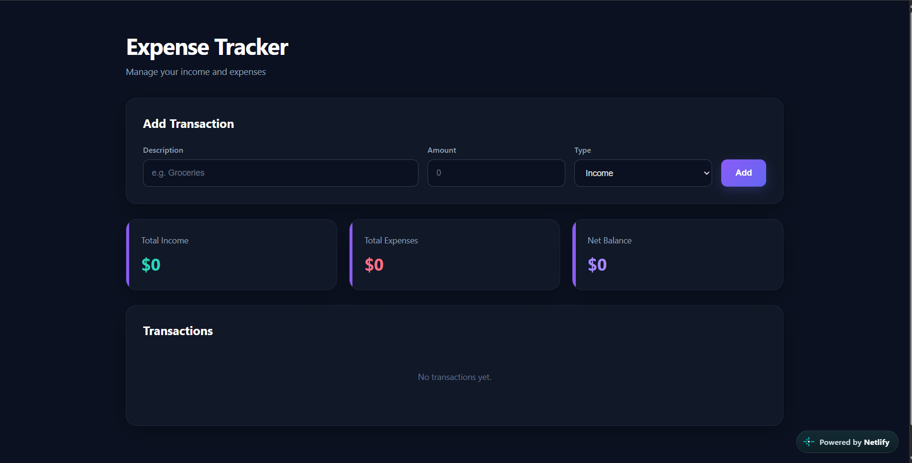

# 💰 Expense Tracker

A simple and interactive expense tracking application built with React that helps users manage their income and expenses, track transactions, and monitor their overall financial balance.

## 🌐 Live Demo

[**View Expense Tracker**](https://expense-tracker-by-azariya.netlify.app/)

## 📸 Screenshot



## ✨ Features

* **Add Transactions:** Record income and expenses with a description, amount, and transaction type.
* **Edit Transactions:** Update existing transactions whenever details change.
* **Delete Transactions:** Remove transactions you no longer need.
* **Income Tracking:** Calculate and display total income.
* **Expense Tracking:** Calculate and display total expenses.
* **Net Balance:** Automatically calculate your balance by subtracting total expenses from total income.
* **Transaction History:** View your recorded transactions in a list.
* **Visual Indicators:** Easily distinguish between income and expense transactions.
* **Empty State:** Display a message when no transactions have been added.

## 🛠️ Technologies Used

* React
* JavaScript (ES6+)
* HTML5
* CSS3

## 🚀 Getting Started

Follow these steps to run the project locally.

### Prerequisites

* [Node.js](https://nodejs.org/) and npm, if your project uses a Node.js-based development setup.
* A modern web browser.

### Installation

1. Clone the repository:

   ```bash
   git clone https://github.com/Azaariya/Expense-Tracker.git
   ```

2. Navigate to the project folder:

   ```bash
   cd Expense-Tracker
   ```

3. Install dependencies and start the development server if your project uses a setup such as Vite:

   ```bash
   npm install
   npm run dev
   ```

   If your project uses React through browser scripts in `index.html` instead, open `index.html` in your browser or use the VS Code Live Server extension.

## ⚙️ How It Works

1. Enter a transaction description and amount.
2. Choose whether the transaction is income or an expense.
3. Add the transaction to your list.
4. Edit or delete transactions as needed.
5. View the updated income total, expense total, and net balance.

**Note:** Transactions are currently stored in React state, so they reset when the page is refreshed.

## 📚 What I Learned

Building this project helped me practice:

* Creating reusable React components.
* Managing application data with React state and `useState`.
* Using `useEffect` to populate the form when editing a transaction.
* Passing data and functions between components through props.
* Handling form submissions and user interactions.
* Updating, adding, and deleting items in an array.
* Calculating totals using JavaScript's `filter()` and `reduce()` methods.
* Rendering lists dynamically in React.

## 🔮 Future Improvements

* Save transactions using local storage so they persist after refreshing the page.
* Add transaction search and filtering.
* Introduce expense categories.
* Add monthly and yearly financial summaries.
* Include charts to visualize spending patterns.
* Improve form validation and currency formatting.

## 👨‍💻 Author

**Azaria**

Fourth-year Electrical and Computer Engineering student at Addis Ababa Science and Technology University.

* **GitHub:** [Azaariya](https://github.com/Azaariya)
* **Project Repository:** [Expense Tracker](https://github.com/Azaariya/Expense-Tracker)
* **Live Demo:** [Expense Tracker](https://expense-tracker-by-azariya.netlify.app/)

---

*Built as a project to practice React, JavaScript, and frontend development.*
